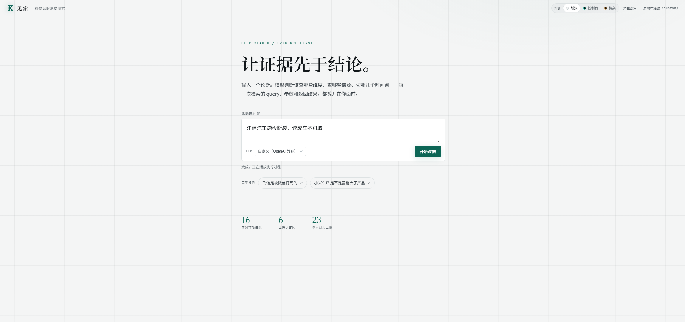
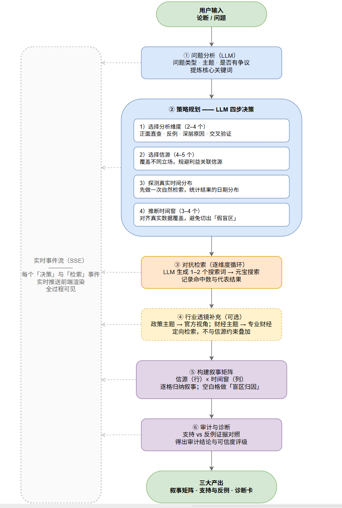
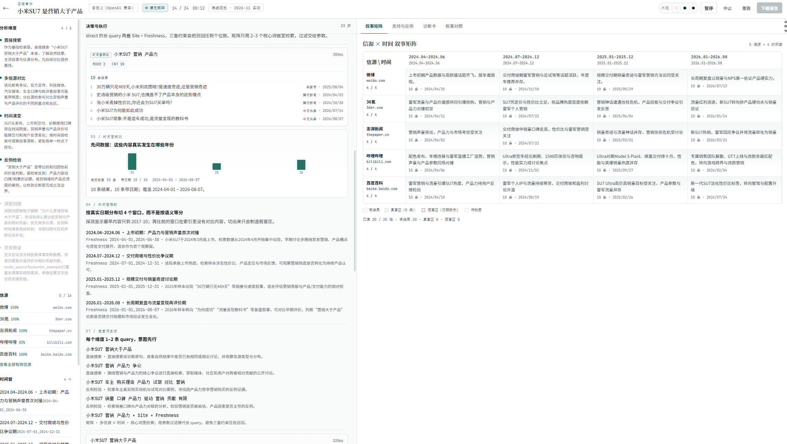

# 见索 · 看得见的深度搜索



输入一个论断或问题，模型自动决定分析维度、信源与时间窗；元宝搜索做「多信源 × 多时间窗」的对抗检索；全过程实时渲染；最终产出 **叙事矩阵 + 支持与反例 + 诊断卡**。

区别于通用 deep research：不给你一篇综合报告，而是把「谁在说、谁没说话、叙事怎么随时间变化」摊开。

## 检索流程



从论断出发，经过问题分析、维度与信源选择、时间分布探测、时间窗划分、多信源 × 多时间窗检索，最后进入反例检验与审计结论。

## 界面预览



## 运行

```bash
cp .env.example .env   # 填入腾讯云密钥，以及至少一个 LLM key
uv run python -m uvicorn server:app --host 127.0.0.1 --port 8011
```

浏览器打开 `http://127.0.0.1:8011`。

- 内置「飞信」「小米 SU7」两个案例：离线回放，秒开
- 其他输入：走真实检索（约 2–4 分钟），取决于模型的速度，页面实时渲染决策与检索过程

> 必须通过 HTTP 服务访问；直接双击 HTML（file://）无法调用后端。

## 结构

- `server.py`：Starlette + uvicorn，托管原型并提供 `POST /api/run`（SSE）
- `src/`：检索 pipeline
  - `planner.py`：LLM 决策（分析 / 选维度 / 选信源 / 探时间窗 / 生成搜索词）
  - `matrix.py`：信源 × 时间窗叙事矩阵（含盲区归因）
  - `audit.py`：支持 vs 反例 + 审计结论 + 诊断卡
  - `search.py`：元宝搜索封装（Query / Site / Freshness / Industry）
  - `llm.py`、`config.py`、`sites.py`、`dimensions.py`、`events.py`
  - `web_adapter.py`：把 pipeline 结果映射为前端 case 契约
- `web/index.html`：前端原型（“见索”）
- `web/cases/`：内置案例录像（`mi.js` / `feixin.js`）
- `run.py`：不经 Web 的 CLI 调试入口